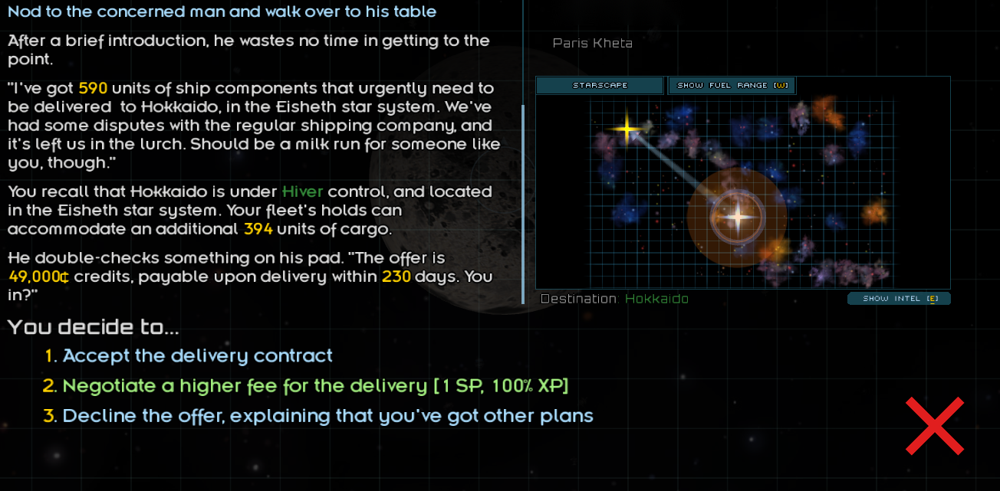
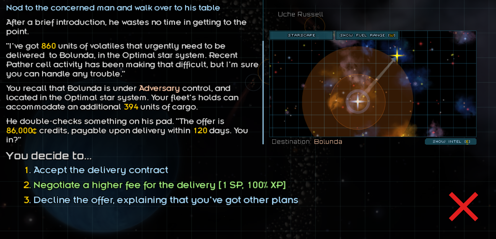

# Faction Mission Blacklist

A small utility mod for Starsector that stops vanilla missions, most noticeably the
"deliver X to Y" bar event, from constantly sending you to boss factions like
**Adversary** and **Hivers**.




## Why

Boss factions are hostile to almost everyone, so their markets are permanently short on
goods. The vanilla delivery bar event weighs destinations heavily by shortage size, so it
ends up picking those markets almost every time: places you usually can't or don't want
to go.

## How it works

Starsector already has a built-in "invalid mission target" flag on markets, and vanilla
missions skip any market with it set. Mods just rarely set it. This mod:

- sets the flag on every market owned by a blacklisted faction,
- re-checks once per in-game day, so new or conquered markets are covered,
- removes the flag again if a market it flagged is taken over by a normal faction,
- clears all of its flags right before the game saves and restores them right after,
  so **nothing from this mod is ever stored in your save**.

Side effect: other vanilla missions and bar events that check the same flag will also skip
those factions. The factions' own content is not affected.

## Default blacklist

| Faction | ID |
|---|---|
| Adversary | `adversary` |
| Hiver | `HIVER` |

Factions you don't have installed are ignored.

## Adding factions

Edit `data/config/settings.json` and add the faction ID to `factionMissionBlacklist_factions`.
Find IDs in that mod's `data/world/factions/` folder (file name without `.faction`) or with
Console Commands: `list factions`. IDs are case-sensitive.

Other mod authors can blacklist their own boss faction from their mod, without touching this
one, by adding the same key to their own `data/config/settings.json` (Starsector merges the lists):

```json
{
	"factionMissionBlacklist_factions":["my_boss_faction"],
}
```

## Installation

1. Extract into `Starsector/mods/` so you have `mods/FactionMissionBlacklist/mod_info.json`.
2. Enable it in the launcher.

**Save compatibility:** completely safe to add to or remove from a save at any time. Nothing
from the mod is written into the save file, so removing it leaves the save exactly as if it had
never been installed. Delivery offers you already have keep their destination; new ones are
filtered.

No dependencies. Compiled from source by the game, no jar needed.

**Upgrading from FactionMissionFilter 1.0.0:** delete the old `FactionMissionFilter` folder,
install this one, and enable **Faction Mission Blacklist** in the launcher. Leftover flags from
the old version are cleaned up automatically the next time you save.

## Changelog

See [CHANGELOG.md](CHANGELOG.md).

## License

MIT, see [LICENSE](LICENSE). Feel free to fold this into your own mod or modpack.

Not affiliated with the Adversary or Hivers mods; no files from either mod are included.
